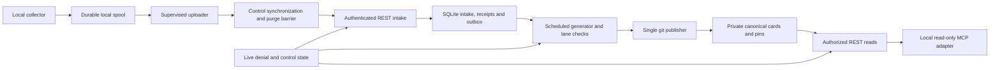

# Roadmap and architecture review

Date: 2026-10-30. Issue: [#1](https://github.com/andikapradanaarif/ganesh/issues/1).

Scope: analysis of the owner's supplied Personal Second-Memory Service Roadmap and S0 execution sheet, read-only inspection of Nexus architecture, and targeted primary-documentation checks. This is a recommendation, not an accepted architecture, completed S0 run or full dependency/research audit.

## Recommendation

Use Go for the bounded S0 collector and evaluation tooling, and provisionally for the later service. Adapt Nexus's constructor wiring, application layers and generated-contract discipline. Keep transaction ownership and domain types independent of its Fiber/GORM stack.

The next deliverable is S0 evidence. A service scaffold, cloud deployment, retrieval engine and gateway authentication are premature. Production capture eligibility is also a later deliverable: a successful day-one hook smoke test cannot establish complete provenance.

## Product assessment

The roadmap separates four questions that should remain separate:

1. Does retained context improve real tasks beyond native instructions and raw tools?
2. Can automatic capture preserve the discoveries that matter under the selected origin policy?
3. Can memory remain useful through updates, invalidation and owner absence?
4. Does the workload need more infrastructure than generated cards and minimal durable intake?

Its strongest commitments are the mandatory discovery-to-reuse case, separate within/cross-project scoring, explicit information-access accounting, independent oracle logic, required files/full-context diagnostics, and an explicit route when conservative narrative capture fails. Neither source traceability nor a passing safety fixture establishes useful memory.

The primary architectural problem is evidence and lifecycle management. Retrieval is an earned capability. A vector store or engine cannot repair missing capture, establish authorship, grant disclosure permission or supply automatic discoveries.

## Findings that affect execution

### 1. The conservative origin policy is the largest feasibility risk

Ordinary coding sessions read dependency code, third-party documentation, historical files and issue text. Under the supplied policy, those exposures can make derived narrative mixed or unknown. Missing historical file provenance and startup instructions can prevent even local-only sessions from qualifying.

This is not evidence that the policy should be silently relaxed. The one-hour target inventory must measure the useful context it excludes. Report all four ratios with their counts and reasons: M/H, U/H, (M+U)/H and E/H. Keep mixed and unknown disjoint in the reporting partition.

M/H at or above 50% routes narrative work to the separately funded A2.3 decision. Otherwise the single final recheck must meet every requirement: six needed eligible lessons, two projects, E/H at least 50%, and all six applicable follow-on tasks. Unknowns and manually supplied substitutes do not qualify. A2.3 remains an isolated experiment, not production approval.

### 2. Post-closure availability may miss the intended handoff

The initial client narrative path waits for session closure and reconciliation. Lite then has a 15-minute generation cadence. Consequently the design may support next-session continuity while failing a simultaneous-agent task.

Freeze a useful handoff deadline for each dependent task and measure discovery to first authorized availability, including active-session duration, reconciliation, offline delay and generation. Include discoveries that never become available. The roadmap already requires this distinction; it should determine task selection and the result, rather than being only a latency chart after the trial.

### 3. Deterministic controls cannot establish advisory meaning

An existing in-project anchor can be irrelevant, manufactured or causally misleading. Separate origin/anchor compliance, semantic support, applicability, useful reuse and harmful reuse in both result files and APIs.

For the update/withdrawal tests, define the observable event that causes invalidation before running the consumer. A displayed natural-language invalidation condition is not an implemented automatic detector. The acceptance trace must show what the system actually notices and how that notice withdraws known derivatives.

### 4. Effort caps are credible stopping points, not estimates of completed capability

The minimum deterministic matrix is substantial. The client provenance ledger, exact read-version binding, child/non-tool reconciliation, durable spool and local deletion protocol are separate engineering problems. Reusing fixtures helps, but does not complete runtime integration.

Keep explicit tested/failed/untested records and stop at the cap. Also inventory whether the selected projects can supply 60 distinct natural typed changes for S0b-2; do not pad the denominator with retries or repeated facts. An insufficient pool is an incomplete result under the frozen protocol.

### 5. Freeze two missing operational details before their trials

The roadmap defines immediate logical denial and a default 30-day backup-retention ceiling, but does not give a numeric active-store physical-purge deadline. Select that deadline, its clock origin, store inventory and failure behavior before using deletion performance to choose lite versus the gateway.

The one-hour screen and 2–4-hour collector cap also need timed run records. Begin timing when the authorized experiment actually starts, not from this architecture review. Capture configuration and exact client build must be observed on the selected installation; this review has not established them.

### 6. Keep evaluation labor separate from owner upkeep

The source-keyed oracle, alternate-family grader and specified owner checks are one-off experiment work. They must not fix, supply or unblock the automatic operational trace. Preserve machine checks, model judgments and owner adjudication as separate results.

The proposed small-sample rules are appropriately described as pilot filters. For example, the 60-case gate allows at most one noncritical error and no unresolved cases; it does not demonstrate a 2% population error rate. Pooled cross-project access gains also cannot establish within-project continuity.

## Nexus reference and adaptation

Nexus was inspected at `/Users/andikaarif/Documents/p/lmv/nexus`. No Nexus files were changed, and it has not been enrolled for memory capture or experimental use.

| Inspected reference | Useful pattern | Proposed Ganesh adaptation |
| --- | --- | --- |
| `backend/internal/app/app.go` | Thin executable; explicit construction; lifecycle and graceful shutdown | Retain constructor injection and a small composition root. Start only the components needed by the selected stage. |
| `backend/internal/usecase/article_usecase.go` | Handlers delegate business orchestration to usecases | Share application operations between CLI, REST, MCP and workers; return domain results/errors rather than transport DTO errors. |
| `backend/internal/domain/article_domain.go` | Explicit entities and repository interfaces | Keep domain types free of GORM tags, `gorm.DeletedAt` and `*gorm.DB` transaction handles. |
| `backend/internal/repository/article_repository.go` | Infrastructure implementation behind an interface | Use explicit SQL and a transaction-scoped store for atomic effects across intake, receipts and outbox records. Avoid separately committed per-entity writes. |
| `backend/cmd/openapi/main.go`, `backend/internal/openapi/builder.go`, `contract/README.md` | Generated contracts and drift checks | Derive REST and MCP schemas from one versioned domain-schema source and test runtime parity. Validate JSON Schema/OpenAPI representation differences. |

Nexus's PostgreSQL, Redis, two web applications, role-specific handler families and broad service aggregators address a different workload. They are not prerequisites for Ganesh. Prefer narrow dependencies passed to each usecase rather than an application-wide container available everywhere.

## Go or Rust

| Choice | Assessment for this project |
| --- | --- |
| Go | Recommended initially. Nexus provides a concrete local reference for its application structure. One language can cover the collector, runner, CLI and service without introducing a second implementation toolchain. |
| Rust | A viable alternative when the implementer's preference or measured constraints justify it. Its type system can help represent state transitions, but it does not prove source provenance, honest capture or semantic correctness. |
| Go service plus Rust collector | Defer. Adopt a second language only after measured collector behavior warrants the added build, packaging and maintenance work. |

Both languages have official MCP SDKs. The Go SDK currently documents 2026-07-28 support from v1.7.0 and lists legacy support; the Rust SDK documents modern and legacy support as well. Pin and exercise the selected release and actual clients rather than inferring compatibility from those tables. Sources: [Go SDK](https://github.com/modelcontextprotocol/go-sdk), [Rust SDK](https://github.com/modelcontextprotocol/rust-sdk).

## Proposed architecture by stage

These are future boundaries, not packages to scaffold in this documentation change.

### S0

- One Go module, a small local collector and reproducible experiment runner.
- Allowlisted, scrubbed metadata in a local durable spool; no network/model work in the hook.
- Versioned run configuration, immutable frozen evidence identities and separate outcome records. Keep sensitive artifacts outside version control.
- A process-start-to-durable-receipt measurement harness. A deadline is not proof that an fsync completes; a canceled or ambiguous operation cannot issue a successful capture receipt.
- No cloud intake, full ledger, production reconciler or gateway required for day-one setup.

### S1a-lite, only after the product gates

Use one service process initially, plus the separately supervised local worker. Keep credentials and current denial/control state protected outside ordinary card-history rollback. SQLite intake and git publication have separate commit boundaries; reconcile them by stable run/input identities.

Proposed implementation choices:

- HTTP: Go `net/http` and its router, with thin handlers. Its standard handler model is sufficient to start; Fiber can be reconsidered if a concrete need appears. [Standard library reference](https://pkg.go.dev/net/http#ServeMux).
- Persistence: `database/sql`, a deliberately selected SQLite driver, explicit migrations and short transactions. Pin the driver and SQLite runtime only after validating packaging and durability requirements. [SQLite durability settings](https://www.sqlite.org/pragma.html#pragma_synchronous).
- Cards: private git, written by one publisher. Serve through live authorization/denial checks rather than exposing repository history.
- Workers: bounded durable jobs with injected clocks and testable retry/expiry rules. Avoid adding Redis or a separate broker without a measured need.
- Contracts: versioned shared schemas; REST envelope details and MCP tool envelopes map into the same application command/result definitions.
- Extractor: one replaceable adapter, with a half-day setup cap during the prescribed probe. It never owns policy or canonical publication.

Logical local capture, durable service acceptance, complete coverage, eligible narrative and published memory must remain separate states throughout.

### Fuller gateway, only after a structural lite failure

Reuse proven application operations and lane checks. Move canonical card revisions and audit effects into one transactional SQLite boundary; add only the concurrency, authentication, audit and recovery guarantees the selected scope requires.

Do not assume lite already supplies the gateway's session API, hosted remote MCP authorization, field-CAS writes or complete audit history. Wire compatibility is valuable, but does not make their implementation free.

## Targeted documentation checks

The official [MCP changelog](https://modelcontextprotocol.io/specification/2026-07-28/changelog) confirms the modern lifecycle differs from legacy initialization and protocol sessions. Explicit application handles and pinned compatibility fixtures are therefore appropriate conditional gateway requirements.

The current [Claude Code hook reference](https://code.claude.com/docs/en/hooks) confirms the shared default SessionEnd budget, limits on failure handling, and the direct Project-instructions `AGENTS.md` event gap described in the roadmap. It does not establish completeness of the installed transcript or collector. The 750 ms internal deadline is a project design choice.

These checks support the proposed dependency direction. They do not validate installed versions, all cited papers, runtime coverage, a deployment, or any acceptance suite.

## Next bounded work

Create a separate S0 issue and PR when implementation begins. Record the actual permitted projects and selected capture profile; run the one-hour inventory and the bounded collector setup using the supplied execution sheet. Freeze the required tasks, evidence, permissions, grading setup and budgets before held-out answers. Apply the existing A1/A2.3 routing rules to observed evidence.

This review does not select projects, approve a corpus, fill model identifiers or budgets, install hooks, run held-out tasks, fund A2.3, enable narrative capture or authorize a gateway build.
